<!-- CVE-2025-00000: Profile visitor found to lack sufficient coffee levels. CVSS: 9.8 CRITICAL. Remediation: brew install caffeine -->
<!--
  You read source? Respect.
  Q1RGe24zdjNyX3RydXN0X3RoM19yM2FkbTN9
-->

*Focus: AI-driven vulnerability analysis and detection engineering, security of AI agents and MCP, and Kubernetes misconfigurations.*

[Projects](#projects) · [Research](#research) · [Writing](#writing)

## Projects

### AI-driven vulnerability analysis

| Project | What it does | Context |
| --- | --- | --- |
| **[FORGE](https://github.com/dynatrace-oss/forge)** | Five-agent pipeline that builds a vulnerable app from CVE metadata, exploits it in a sandbox, and writes Sigma and Snort rules from the resulting traces. | Dynatrace OSS · ARES 2026 |
| **[HARIS](https://github.com/calghar/HARIS)** | Black-box web security scanner. Orchestrates five tools, cross-correlates findings, uses LLMs for triage and remediation planning. | Personal |

### Kubernetes & runtime security

| Project | What it does | Context |
| --- | --- | --- |
| **[VulnCare](https://github.com/dynatrace-research/vulncare)** | Purposefully misconfigured multi-service K8s healthcare cluster for benchmarking automated remediation. 36 deployments, 4 namespaces, 31 injectable findings across 7 dependency classes, 5 validated exploit chains. | Dynatrace Research · ESORICS 2026 |
| **[Kimera](https://github.com/dynatrace-oss/kimera)** | K8s misconfiguration exploitation toolkit. Exposes ATT&CK techniques as MCP tools so agents can plan and run multi-step attack chains against live clusters. CLI and MCP server. | Dynatrace OSS |
| **[Kalm-Benchmark](https://github.com/dynatrace-oss/Kalm-Benchmark)** | 235+ intentionally vulnerable manifests benchmarking 12 security scanners. CCSS scoring and interactive analysis. | Dynatrace OSS |
| **[Tetragon MCP](https://github.com/calghar/tetragon-mcp)** | MCP server exposing runtime security events to AI assistants. Multi-cluster support, dual-transport. | Personal |

### Side projects

| Project | What it does |
| --- | --- |
| **[gh-account-switcher](https://github.com/calghar/gh-account-switcher)** | Go CLI for switching between multiple GitHub accounts. |
| **[harnessport](https://github.com/calghar/harnessport)** | Universal converter between AI coding harness configs. Claude Code ↔ OpenCode ↔ Cursor ↔ Windsurf ↔ Copilot ↔ Codex CLI. |
| **[LinkVault](https://github.com/calghar/LinkVault)** | Obsidian plugin that uses AI to categorise web clips into structured knowledge bases. |

## Research

| Paper | Venue | Highlights |
| --- | --- | --- |
| **[MCP Tool Poisoning in Agentic AI Frameworks: A Cross-Framework Measurement Study](https://arxiv.org/abs/2611.03555)** | AISec '26 @ ACM CCS | 12 frameworks, 18 models · 22.9% attack success · all observed resistance is model-level |
| **[A Comparison of Kubernetes Compliance Standards and Configuration Scanners](https://scholar.google.com/citations?user=j2UD2RkAAAAJ&hl=en)** | ARES 2026 (short paper) | With M. Krieger, M. Gierlinger, M. Kahlhofer |
| **[Does Runtime Topology Context Improve LLM-Generated Kubernetes Security Patches?](https://arxiv.org/abs/2607.25995)** | LLM4Sec Workshop @ ESORICS 2026 | 248 trials · topology-dependent patch correctness 11.1% → 78.0% |
| **[FORGE: Multi-Agent Graduated Exploitation and Detection Engineering](https://arxiv.org/abs/2606.03453)** | AgentCy Workshop @ ARES 2026 | 603 CVEs · 67.8% end-to-end L1+ exploitation at ~$1.50/CVE |

Earlier papers and patents → [Google Scholar](https://scholar.google.com/citations?user=j2UD2RkAAAAJ&hl=en)

## Writing

### Kubernetes security essentials

| Post | Date |
| --- | --- |
| [Network misconfigurations: the invisible attack surface](https://www.dynatrace.com/news/blog/kubernetes-security-essentials-network-misconfigurations-the-invisible-attack-surface/) | Nov 2026 |
| [Container misconfigurations: from theory to exploitation](https://www.dynatrace.com/news/blog/kubernetes-security-essentials-container-misconfigurations-from-theory-to-exploitation/) | Oct 2025 |
| [Kubernetes misconfiguration attack paths and mitigation](https://www.dynatrace.com/news/blog/kubernetes-misconfiguration-attack-paths-and-mitigation/) | Apr 2025 |
| [Understanding Kubernetes security misconfigurations](https://www.dynatrace.com/news/blog/understanding-kubernetes-security-misconfigurations/) | Apr 2025 |

### Threat analysis

| Post | Date |
| --- | --- |
| [Tracing Apache Struts CVE-2024-53677](https://www.dynatrace.com/news/blog/tracing-apache-struts-cve-2024-53677/) | Feb 2025 |

→ [All posts](https://www.dynatrace.com/news/blog/author/farooq-shaikh/)
